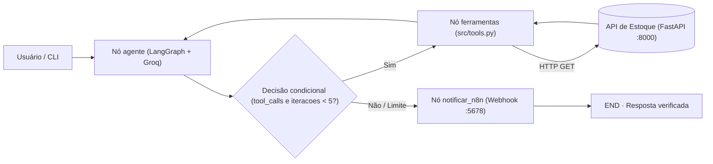

# Agente de IA para Análise de Estoque

Projeto avaliativo desenvolvido individualmente por **Renan Rosa Ferreira** para o curso **[SCTEC C1] CT Aperfeiçoar — Agentes de IA (T2)**.

[](https://www.linkedin.com/in/renanrosaferreira/)
[](https://github.com/renanrosaf)

## 1. Problema e objetivo

Empresas precisam acompanhar continuamente a disponibilidade de produtos para evitar rupturas de estoque ou compras desnecessárias. A [API de Estoque](https://github.com/wangsouza/api-estoque) disponibilizada pelo professor fornece apenas os dados brutos de cada item (`quantidade_atual` e `estoque_minimo`), sem classificar a situação nem gerar alertas.

Este projeto implementa um **agente de IA em Python com LangGraph** capaz de interpretar solicitações em linguagem natural, consultar a API de Estoque sob demanda por meio de ferramentas HTTP, classificar a situação dos produtos (**esgotado**, **estoque baixo**, **no limite mínimo** ou **normal**), responder perguntas conceituais sem consultas desnecessárias e acionar uma **automação complementar no n8n** sempre que detectar itens críticos.

## 2. Vídeo demonstrativo

- **Link do vídeo (até 5 minutos):** *(adicionar o link público ou não listado após a gravação na etapa final)*

## 3. Tecnologias utilizadas

- **Linguagem:** Python 3.11+
- **Orquestração do agente:** LangGraph (`StateGraph`, `ToolNode`, transição condicional e limite de iterações)
- **LLM:** Groq API (`openai/gpt-oss-120b` via `langchain-groq`)
- **Integração HTTP e validação:** `httpx`, `pydantic`, `python-dotenv`
- **API de dados (apoio):** [API de Estoque (FastAPI)](https://github.com/wangsouza/api-estoque) executada localmente em `http://127.0.0.1:8000`
- **Automação complementar:** n8n executado localmente via Docker (`http://localhost:5678`)

## 4. Arquitetura da solução



### Estrutura do LangGraph (`src/graph.py`)

- **Estado compartilhado (`AgentState`):** armazena o histórico de mensagens (`messages` com `add_messages`), o contador explícito `iteracoes` e os retornos `alertas_n8n`.
- **Nós funcionais (3 nós):** `agente` (invoca o LLM com `SystemMessage` estruturado em **Papel, Objetivo, Contexto e Restrições**), `ferramentas` (`ToolNode` com as 3 ferramentas HTTP) e `notificar_n8n` (envia os produtos consultados ao Webhook do n8n dentro do próprio grafo).
- **Transição condicional (`decidir_proximo_passo`):** decide entre acionar `ferramentas` ou seguir para `notificar_n8n → END` (sem chamar API em perguntas conceituais ou fora do escopo).
- **Condição de parada e fallback:** trava dupla com `MAX_ITERACOES = 5` e `recursion_limit = 14`, além de mensagem explícita de fallback caso o limite seja atingido sem resposta textual.

### Ferramentas Python integradas à API (`src/tools.py`)

- `consultar_produto(codigo)`: valida previamente o padrão `^PRD-[0-9]{3}$`, realiza `GET /produtos/{codigo}` com `timeout=5s` e trata de forma controlada `404` (`produto_nao_encontrado`), `422` (`codigo_invalido`), `503` (`servico_indisponivel`, incluindo `PRD-503`), timeouts e falhas de conexão.
- `listar_produtos(categoria=None)`: consulta `GET /produtos` com filtro opcional por categoria.
- `listar_categorias()`: consulta `GET /categorias` para obter as categorias válidas cadastradas.


### Regras de classificação adotadas pelo agente

A classificação é calculada em Python como **fonte única de verdade** em `src/tools.py` (evitando divergência entre o texto do LLM e o payload do n8n). Seguindo o critério do README da API do professor, itens exatamente no limite mínimo (`PRD-005` e `PRD-009`) são tratados como **estoque baixo** com sinalização `no_limite_exato: true`, garantindo alerta preventivo de reposição.

| Condição | Classificação (`situacao`) | Comportamento no n8n |
|---|---|---|
| `quantidade_atual == 0` | **Esgotado** (`esgotado`) | `ALERTA_ENVIADO` (`URGENTE`) |
| `0 < quantidade_atual <= estoque_minimo` | **Estoque baixo** (`estoque_baixo`, inclui limite exato com `no_limite_exato: true`) | `ALERTA_ENVIADO` (`ALTA`) |
| `quantidade_atual > estoque_minimo` | **Normal** (`normal`) | `SEM_ALERTA` (ramo `false` do `IF`) |

## 5. Automação complementar com n8n

O workflow **`Alerta de Estoque Crítico`** (exportado em [n8n/workflow_alerta.json](n8n/workflow_alerta.json) atua **após** a análise do LangGraph, sem substituir a lógica principal do agente:

1. **Webhook (`POST /webhook/alerta-estoque`):** recebe do cliente Python (`src/n8n_client.py`) os dados do produto analisado e sua situação.
2. **IF:** valida se `situacao` é `esgotado` **OU** `estoque_baixo`.
3. **Edit Fields (Set):** gera prioridade (`URGENTE` para esgotado, `ALTA` para estoque baixo), mensagem formatada de reposição e carimbo de data/hora (`registrado_em`).
4. **Respond to Webhook:** retorna o JSON estruturado de confirmação de volta para a aplicação Python (ou `SEM_ALERTA` no ramo `false`).

### Evidência de execução do workflow no n8n

[n8n/evidencia_execucao_n8n.png]

## 6. Organização dos arquivos

```text
agente-analise-estoque/
├── n8n/
│   ├── workflow_alerta.json        # Workflow exportado do n8n
│   └── evidencia_execucao_n8n.png  # Print da execução com sucesso no n8n
├── src/
│   ├── __init__.py
│   ├── config.py                   # Carregamento e validação de variáveis (.env)
│   ├── tools.py                    # Ferramentas HTTP integradas à API de Estoque
│   ├── graph.py                    # Estado, nós, transição condicional e grafo LangGraph
│   ├── n8n_client.py               # Cliente HTTP para disparo de alertas no Webhook n8n
│   └── main.py                     # Interface CLI interativa
├── tests/
│   ├── run_tests.py                # Script reproduzível dos 5 cenários de teste
│   └── evidencias.md               # Relatório gerado com entradas, saídas e logs JSON
├── .env.example                    # Modelo de variáveis de ambiente (sem chaves reais)
├── .gitignore
├── requirements.txt
└── README.md
```

## 7. Configuração e execução

### Pré-requisitos

- Python 3.11+
- [API de Estoque](https://github.com/wangsouza/api-estoque) clonada e em execução local em `http://127.0.0.1:8000`
- Docker Desktop (para executar o n8n localmente em `http://localhost:5678`)
- Chave de API gratuita da [Groq](https://console.groq.com/)

### Passo 1 — Subir a API de Estoque (em pasta separada)

```powershell
git clone https://github.com/wangsouza/api-estoque.git
cd api-estoque
python -m venv .venv
.venv\Scripts\Activate.ps1
pip install -r requirements.txt
python -m uvicorn app.main:app --reload --host 127.0.0.1 --port 8000
```

### Passo 2 — Subir o n8n local e importar o workflow

```powershell
docker volume create n8n_data
docker run -it --rm --name n8n -p 5678:5678 -e TZ="America/Sao_Paulo" -e GENERIC_TIMEZONE="America/Sao_Paulo" -v n8n_data:/home/node/.n8n docker.n8n.io/n8nio/n8n
```

Acesse `http://localhost:5678`, importe o arquivo `n8n/workflow_alerta.json` pelo menu **`⋯` → Import from File...** e clique em **Publish**.

### Passo 3 — Configurar e executar o agente

```powershell
git clone https://github.com/renanrosaf/agente-analise-estoque.git
cd agente-analise-estoque
python -m venv .venv
.venv\Scripts\Activate.ps1
pip install -r requirements.txt
```

Copie `.env.example` para `.env` e preencha sua chave em `GROQ_API_KEY`:

```env
GROQ_API_KEY=sua_chave_groq_aqui
GROQ_MODEL=openai/gpt-oss-120b
API_ESTOQUE_URL=http://127.0.0.1:8000
N8N_WEBHOOK_URL=http://localhost:5678/webhook/alerta-estoque
```

Execute a interface interativa do agente:

```powershell
python -m src.main
```

## 8. Testes e evidências

Para reproduzir os **3 cenários obrigatórios** e os **2 cenários bônus de confiabilidade/segurança**, execute:

```powershell
python -m tests.run_tests
```

| # | Cenário | Iterações | Ferramentas | Retorno n8n | Resultado |
|---|---|---:|---|---|---|
| 1 | Análise de estoque baixo (`PRD-001`) *(Obrigatório)* | 2 | `consultar_produto` | `ALERTA_ENVIADO` | **PASSOU** |
| 2 | Produto inexistente `PRD-999` — HTTP 404 *(Obrigatório)* | 2 | `consultar_produto` | Não acionado | **PASSOU** |
| 3 | Pergunta conceitual sem chamar API *(Obrigatório)* | 1 | `nenhuma` | Não acionado | **PASSOU** |
| 4 | Caso de borda no limite mínimo (`PRD-005` — 30/30) *(Bônus)* | 2 | `consultar_produto` | `ALERTA_ENVIADO` | **PASSOU** |
| 5 | Produto em estoque normal (`PRD-002` — ramo `false` do `IF`) *(Bônus)* | 2 | `consultar_produto` | `SEM_ALERTA` | **PASSOU** |
| 6 | Fora do escopo e tentativa de cadastro não autorizado *(Bônus)* | 1 | `nenhuma` | Não acionado | **PASSOU** |
| 7 | Indisponibilidade simulada `PRD-503` — HTTP 503 *(Bônus)* | 2 | `consultar_produto` | Não acionado | **PASSOU** |

Os logs completos (entrada, resultado esperado, resposta observada e JSON de ferramentas/n8n) estão registrados em [tests/evidencias.md](tests/evidencias.md)).

## 9. Confiabilidade, segurança e limitações

- **Proteção de credenciais:** a chave da API do LLM é carregada exclusivamente via `.env`, listado no `.gitignore` (nunca versionado).
- **Operação segura (somente leitura):** o agente utiliza apenas endpoints `GET` da API de Estoque, evitando modificações não autorizadas na base de dados; caso o endpoint `POST /produtos` seja adicionado no futuro, exigirá confirmação humana explícita.
- **Limitações conhecidas:**
  - Depende da API de Estoque (`127.0.0.1:8000`) e do n8n (`localhost:5678`) ativos localmente durante o uso.
  - Sujeito aos limites de taxa (*rate limits*) do plano gratuito da Groq API.
  - Executa consultas em turno único via CLI, sem persistência de histórico entre sessões nem interface web dedicada.

## Autor

**Renan Rosa Ferreira**

